<a name="top"></a>
<div align="center">
    
    <h1>Aplikasi Web Uptime Kuma</h1>
    <p><b>Tugas Proyek Akhir Mata Kuliah Komunikasi Data dan Jaringan Komputer (KDJK)</b></p>

[](https://azure.microsoft.com/)
[](https://www.docker.com/)
[](https://caddyserver.com/)
[](https://letsencrypt.org/)
[](https://kuma-kelompok6.indonesiacentral.cloudapp.azure.com/status/public)

</div>

---

## Anggota Kelompok
[`^ kembali ke atas ^`](#top)

Proyek ini disusun untuk memenuhi tugas akhir mata kuliah **Komunikasi Data dan Jaringan Komputer (KDJK)**:

| NIM | Nama Mahasiswa |
| :--- | :--- |
| `M0403241005` | **Lazarus Prima** |
| `M0403241011` | **Aaliyah Nofarizki** |
| `M0403241058` | **Syazana Aqila** |
| `M0403241065` | **Jeslyn Angelica** |
| `M0403241097` | **Ferdy Alfalah** |

<hr />

[Sekilas Tentang](#sekilas-tentang) | [Spesifikasi Server](#spesifikasi-kebutuhan-server) | [Instalasi](#instalasi) | [Konfigurasi](#konfigurasi) | [Maintenance](#maintenance) | [Otomatisasi](#otomatisasi) | [Cara Pemakaian](#cara-pemakaian) | [Pembahasan](#pembahasan) | [Referensi](#referensi)

---

## Sekilas Tentang
[`^ kembali ke atas ^`](#top)

**Uptime Kuma** adalah aplikasi pemantauan (*monitoring tool*) jaringan dan server *open-source* berbasis web yang dikembangkan oleh Louis Lam. Aplikasi ini dirancang sebagai layanan pemantauan mandiri (*self-hosted*) yang ringan, intuitif, dan bebas biaya lisensi sebagai alternatif dari layanan SaaS komersial seperti UptimeRobot.

Uptime Kuma digunakan untuk memantau ketersediaan (*uptime/downtime*), waktu respon (*latency*), masa berlaku sertifikat SSL/TLS, serta kesehatan layanan internal seperti kontainer Docker secara *real-time*.

Pada proyek ini, Uptime Kuma dijalankan di dua lingkungan: **VM lokal (VirtualBox)** dan **Azure Cloud VPS** yang terhubung ke domain publik ber-SSL HTTPS di **`https://kuma-kelompok6.indonesiacentral.cloudapp.azure.com`**.

### Fitur Utama

- **Antarmuka Modern & Reaktif**: Dashboard reaktif berbasis Vue 3 dan WebSocket (Socket.io) tanpa perlu *refresh* halaman manual.
- **Public Status Page**: Halaman status publik terpisah yang dapat diakses oleh *end-user* tanpa perlu *login*.
- **Integrasi Notifikasi Wide-Range**: Mendukung lebih dari 90+ saluran notifikasi seperti Telegram, Discord, Slack, Email (SMTP), Gotify, dan Webhook.
- **Pemantauan Sertifikat SSL/TLS**: Peringatan otomatis sebelum sertifikat TLS/SSL pada domain target kadaluarsa.
- **Interval Heartbeat Fleksibel**: Frekuensi pengujian ketersediaan layanan dapat dikonfigurasi mulai dari interval 20 detik.
- **Keamanan & Autentikasi**: Mendukung *Two-Factor Authentication* (2FA) dan konfigurasi *Proxy*.

### Protokol & Teknologi Monitoring

- **HTTP(s) / Keyword**: Memantau ketersediaan situs web, kepatuhan kode status HTTP (`200 OK`), dan kata kunci spesifik pada halaman web.
- **ICMP Ping**: Memantau latensi dasar (*Round Trip Time*) dan *packet loss* pada Layer 3 (Network Layer).
- **TCP Port**: Memastikan port spesifik (misal: `80`, `443`, `22`) terbuka dan merespon pada Layer 4 (Transport Layer).
- **DNS Record**: Memantau kecepatan dan keakuratan resolusi nama domain (A, AAAA, CNAME, MX).
- **Docker Socket Engine**: Memantau status kesehatan (*healthcheck*) kontainer Docker lokal via Unix Socket `/var/run/docker.sock`.
- **Caddy Reverse Proxy**: Mengelola pengalihan lalu lintas HTTP/HTTPS dan otomatisasi sertifikat SSL Let's Encrypt.

---

## Spesifikasi Kebutuhan Server
[`^ kembali ke atas ^`](#top)

Berikut rincian spesifikasi server yang digunakan untuk menjalankan Uptime Kuma:

| Komponen | Kebutuhan Minimum | Rekomendasi | Spesifikasi yang Digunakan (Azure VPS) |
| :--- | :--- | :--- | :--- |
| **CPU (Processor)** | 1 vCPU | 1 - 2 vCPU | **1 vCPU** (Standard_B1s) |
| **RAM (Memori)** | 512 MB | 1 GB - 2 GB | **1 GB RAM** |
| **Storage (Penyimpanan)** | 5 GB | 10 GB+ SSD | **30 GB Premium SSD** |
| **Sistem Operasi** | Linux Major Distros | Ubuntu 22.04 LTS | **Ubuntu 22.04.4 LTS (64-bit)** |
| **Jaringan / Port** | Public IP / Bridge | IP Publik + Domain | **1x IPv4 Publik, FQDN Azure** |
| **Port Terbuka** | Port `3001` | Port `80`, `443`, `22` | Port `22` (SSH), `80` (HTTP), `443` (HTTPS) |

---

## Instalasi
[`^ kembali ke atas ^`](#top)

### 1. Instalasi Manual di VM Lokal (VirtualBox)

#### Prasyarat
- **Host**: Laptop / PC dengan Oracle VirtualBox terinstal.
- **Spesifikasi VM**: 1 vCPU, 1024 MB RAM, disk virtual 10 GB.
- **Sistem Operasi**: Ubuntu Server 22.04 LTS ISO.
- **Jaringan VM**: NAT dengan Port Forwarding (`2222 -> 22` SSH, `8080 -> 3001` Web App).
- **Alamat Akses**: `http://localhost:8080` (dari laptop host).

#### Pengaturan Network Port Forwarding di VirtualBox
Sebelum VM dinyalakan, buka **Settings > Network > Adapter 1 > Port Forwarding** dan tambahkan aturan berikut:

| Nama | Protokol | Host Port | Guest Port |
| :--- | :--- | :--- | :--- |
| **SSH** | TCP | `2222` | `22` |
| **UptimeKuma** | TCP | `8080` | `3001` |

#### Proses Instalasi

##### Opsi 1A: Instalasi via Docker (Direkomendasikan)
1. Hubungkan ke VM via SSH dari terminal host:
   ```bash
   ssh -p 2222 ubuntu@127.0.0.1
   ```
2. Update paket sistem dan install Docker Engine:
   ```bash
   sudo apt-get update && sudo apt-get install -y docker.io
   sudo systemctl enable --now docker
   ```
3. Jalankan container Uptime Kuma:
   ```bash
   sudo docker run -d \
     --restart=always \
     -p 3001:3001 \
     -v uptime-kuma:/app/data \
     --name uptime-kuma \
     louislam/uptime-kuma:2
   ```
4. Buka browser di laptop host dan akses: `http://localhost:8080`.

##### Opsi 1B: Instalasi Non-Docker (Node.js & PM2)
```bash
# 1. Install Node.js, Git, dan PM2
curl -fsSL [https://deb.nodesource.com/setup_20.x](https://deb.nodesource.com/setup_20.x) | sudo -E bash -
sudo apt-get install -y nodejs git
sudo npm install pm2 -g

# 2. Clone repositori resmi & jalankan setup
git clone [https://github.com/louislam/uptime-kuma.git](https://github.com/louislam/uptime-kuma.git)
cd uptime-kuma
npm run setup

# 3. Jalankan aplikasi via PM2
pm2 start server/server.js --name uptime-kuma
pm2 save && pm2 startup
```

---

### 2. Instalasi di VPS Cloud (Azure)

#### Prasyarat
- **Penyedia VPS**: Microsoft Azure (Azure for Students).
- **Spesifikasi VPS**: Standard_B1s (1 vCPU, 1 GiB RAM, 30 GB SSD).
- **Domain Aktif (FQDN)**: `kuma-kelompok6.indonesiacentral.cloudapp.azure.com`
- **Cloud Firewall (Azure NSG)**: Port 22 (SSH), Port 80 (HTTP), dan Port 443 (HTTPS) diizinkan (*Allow Inbound*).
- **Web Server / Reverse Proxy**: Caddy Web Server (Auto TLS / SSL Let's Encrypt).

#### Proses Instalasi

1. Login ke server VPS Azure melalui SSH:
   ```bash
   ssh azureuser@kuma-kelompok6.indonesiacentral.cloudapp.azure.com
   ```
2. Update paket sistem dan install Docker Engine:
   ```bash
   sudo apt-get update && sudo apt-get install -y docker.io
   sudo systemctl enable --now docker
   ```
3. Jalankan container Uptime Kuma dengan mount `/var/run/docker.sock` untuk pemantauan kontainer lokal:
   ```bash
   sudo docker run -d \
     --restart=always \
     -p 127.0.0.1:3001:3001 \
     -v uptime-kuma:/app/data \
     -v /var/run/docker.sock:/var/run/docker.sock \
     --name uptime-kuma \
     louislam/uptime-kuma:2
   ```
4. Install Caddy Web Server sebagai Reverse Proxy:
   ```bash
   sudo apt install -y debian-keyring debian-archive-keyring apt-transport-https
   curl -1sLf '[https://dl.cloudsmith.io/public/caddy/stable/gpg.key](https://dl.cloudsmith.io/public/caddy/stable/gpg.key)' | sudo gpg --dearmor -o /usr/share/keyrings/caddy-stable-archive-keyring.gpg
   curl -1sLf '[https://dl.cloudsmith.io/public/caddy/stable/debian.deb.txt](https://dl.cloudsmith.io/public/caddy/stable/debian.deb.txt)' | sudo tee /etc/apt/sources.list.d/caddy-stable.list
   sudo apt update && sudo apt install caddy -y
   ```
5. Buat berkas konfigurasi `/etc/caddy/Caddyfile`:
   ```bash
   sudo nano /etc/caddy/Caddyfile
   ```
   Isi file dengan:
   ```caddy
   kuma-kelompok6.indonesiacentral.cloudapp.azure.com {
       reverse_proxy 127.0.0.1:3001
   }
   ```
6. Restart layanan Caddy untuk menerbitkan sertifikat SSL Let's Encrypt otomatis:
   ```bash
   sudo systemctl restart caddy
   sudo systemctl enable caddy
   ```
7. Aplikasi siap diakses secara aman di URL: `https://kuma-kelompok6.indonesiacentral.cloudapp.azure.com`.

---

### 3. Masalah yang Ditemui dan Solusinya

| No | Gejala / Masalah | Lokasi | Penyebab | Solusi |
| :--- | :--- | :--- | :--- | :--- |
| 1 | Port `3001` harus diketik pada URL browser | VPS Azure | Aplikasi berjalan pada port non-standar `3001` | Pasang Reverse Proxy Caddy untuk meneruskan trafik port `80/443` ke `127.0.0.1:3001`. |
| 2 | Status Monitor Game Server bertanda merah (`[DOWN] Steam API Key not found`) | VPS Azure | Tipe monitor *Steam Game Server* membutuhkan API Key resmi | Ubah tipe monitor menjadi **TCP Port** (`27015`) atau masukkan Steam API Key dari `steamcommunity.com/dev/apikey`. |
| 3 | Tipe monitor *Docker Container* tidak merespon | VPS Azure | Container Uptime Kuma tidak memiliki akses ke socket Docker host | Jalankan ulang container dengan menambahkan parameter `-v /var/run/docker.sock:/var/run/docker.sock`. |
| 4 | Halaman publik meminta login saat diakses pengunjung luar | VPS Azure | Pengunjung mengakses URL `/dashboard` atau Entry Page belum diset ke Status Page | Ubah **Settings > General > Entry Page** menjadi **Status Page** dan bagikan link spesifik `/status/public`. |
| 5 | Peringatan *Connection Refused* saat SSH port `2222` | VM Lokal | Perintah SSH diketik di dalam terminal VM lokal | Jalankan perintah SSH dari PowerShell / Command Prompt laptop Host. |

---

## Konfigurasi
[`^ kembali ke atas ^`](#top)

- **Reverse Proxy & Domain**: Caddy Web Server mengarahkan domain `kuma-kelompok6.indonesiacentral.cloudapp.azure.com` ke port lokal `127.0.0.1:3001` sekaligus mengaktifkan SSL/HTTPS otomatis.
- **Zona Waktu**: Mengatur zona waktu display ke `UTC+07:00 (Asia/Jakarta)` di menu **Settings > General** agar log kejadian dan grafik waktu sesuai dengan WIB.
- **Entry Page**: Diatur dari `Dashboard` menjadi **`Status Page`** agar pengunjung umum yang membuka URL utama langsung diarahkan ke halaman status tanpa prompt login.
- **Penyimpanan Data**: Menggunakan volume persisten Docker `uptime-kuma` yang menyimpan file database SQLite `kuma.db` di `/app/data`.
- **Akses Docker Host**: Mendaftarkan Docker Daemon Socket (`/var/run/docker.sock`) pada menu **Settings > Docker Hosts** untuk pemantauan *container healthcheck*.
- **Public Status Page**: Mengonfigurasi Status Page dengan slug `/status/public` dan menonaktifkan proteksi kata sandi.

---

## Maintenance
[`^ kembali ke atas ^`](#top)

### 1. Memeriksa Status Layanan
```bash
# Memeriksa status kontainer Uptime Kuma
sudo docker ps -f name=uptime-kuma

# Memeriksa status Reverse Proxy Caddy
sudo systemctl status caddy
```

### 2. Melihat Log Aplikasi
```bash
# Memantau 100 baris log terakhir kontainer
sudo docker logs uptime-kuma --tail=100

# Memantau log secara real-time
sudo docker logs -f uptime-kuma
```

### 3. Memperbarui Aplikasi (Update Version)
Prosedur update versi Uptime Kuma dapat dilakukan tanpa menghapus data pemantauan:
```bash
# Hentikan dan hapus kontainer lama
sudo docker stop uptime-kuma && sudo docker rm uptime-kuma

# Unduh image versi terbaru dari Docker Hub
sudo docker pull louislam/uptime-kuma:2

# Jalankan kembali kontainer dengan volume data yang sama
sudo docker run -d \
  --restart=always \
  -p 127.0.0.1:3001:3001 \
  -v uptime-kuma:/app/data \
  -v /var/run/docker.sock:/var/run/docker.sock \
  --name uptime-kuma \
  louislam/uptime-kuma:2
```

### 4. Backup Data Pemantauan
Seluruh riwayat statistik, log, dan daftar monitor disimpan dalam database SQLite di volume `uptime-kuma`.

```bash
# Salin folder data dari kontainer ke direktori backup host
sudo docker cp uptime-kuma:/app/data ./backup_kuma_$(date +%Y%m%d)
```

### 5. Restore Data (Pemulihan Data)
```bash
# Salin file arsip backup kembali ke dalam kontainer
sudo docker cp ./backup_kuma_20261021/. uptime-kuma:/app/data

# Restart kontainer Uptime Kuma
sudo docker restart uptime-kuma
```

---

## Otomatisasi
[`^ kembali ke atas ^`](#top)

Untuk mempermudah deployment penuh di lingkungan server baru, disediakan skrip bash `deploy.sh` yang mengotomatiskan seluruh proses instalasi Docker, Uptime Kuma, dan Caddy SSL:

```bash
#!/bin/bash
# ====================================================================
# Skrip Otomatisasi Deployment Uptime Kuma & Caddy SSL
# Kelompok 6 - KDKJ IPB University
# ====================================================================

set -e

DOMAIN="kuma-kelompok6.indonesiacentral.cloudapp.azure.com"

echo "=== [1/4] Memperbarui Paket Sistem ==="
sudo apt-get update && sudo apt-get upgrade -y

echo "=== [2/4] Menginstal Docker Engine ==="
sudo apt-get install -y docker.io
sudo systemctl enable --now docker

echo "=== [3/4] Menjalankan Kontainer Uptime Kuma ==="
sudo docker run -d \
  --restart=always \
  -p 127.0.0.1:3001:3001 \
  -v uptime-kuma:/app/data \
  -v /var/run/docker.sock:/var/run/docker.sock \
  --name uptime-kuma \
  louislam/uptime-kuma:2

echo "=== [4/4] Menginstal & Mengonfigurasi Caddy SSL ==="
sudo apt install -y debian-keyring debian-archive-keyring apt-transport-https
curl -1sLf '[https://dl.cloudsmith.io/public/caddy/stable/gpg.key](https://dl.cloudsmith.io/public/caddy/stable/gpg.key)' | sudo gpg --dearmor -o /usr/share/keyrings/caddy-stable-archive-keyring.gpg
curl -1sLf '[https://dl.cloudsmith.io/public/caddy/stable/debian.deb.txt](https://dl.cloudsmith.io/public/caddy/stable/debian.deb.txt)' | sudo tee /etc/apt/sources.list.d/caddy-stable.list
sudo apt update && sudo apt install caddy -y

echo "$DOMAIN {
    reverse_proxy 127.0.0.1:3001
}" | sudo tee /etc/caddy/Caddyfile

sudo systemctl restart caddy

echo "===================================================================="
echo "Deployment Selesai! Akses Status Page: https://$DOMAIN/status/public"
echo "===================================================================="
```

### Penjadwalan Backup Otomatis (Cron Job)
Tambahkan entri jadwal cron pada server untuk membuat backup mingguan setiap hari Minggu pukul 02:00 WIB:
```bash
(crontab -l 2>/dev/null; echo "0 2 * * 0 docker cp uptime-kuma:/app/data /var/backups/kuma_\$(date +\%Y\%m\%d)") | crontab -
```

---

## Cara Pemakaian
[`^ kembali ke atas ^`](#top)

Berikut adalah panduan operasional penggunaan fitur-fitur utama Uptime Kuma:

### 1. Autentikasi Login Admin
Akses URL aplikasi, lalu masuk menggunakan kredensial Admin yang telah dibuat saat setup awal.

<div align="center">
    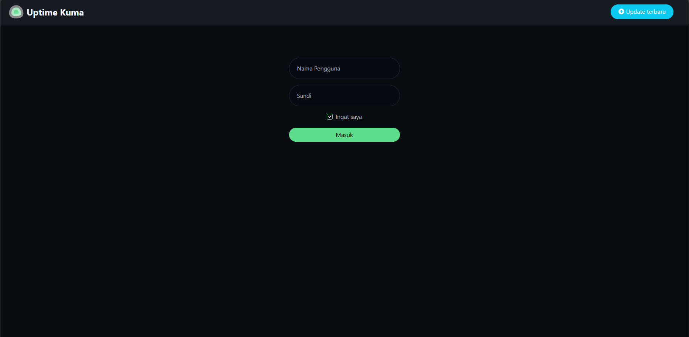
    <p><i>Gambar 1. Antarmuka Login & Autentikasi Admin Uptime Kuma</i></p>
</div>

### 2. Memantau Dashboard & Ringkasan Quick Stats
Dashboard menampilkan statistik ketersediaan monitor (*Up, Down, Maintenance*), grafik latensi *real-time*, dan log kejadian (*event log*).

<div align="center">
    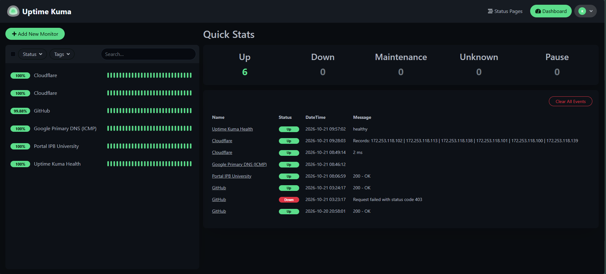
    <p><i>Gambar 2. Tampilan Dashboard Utama, Quick Stats, dan Event Log History</i></p>
</div>

### 3. Menambahkan Target Pemantauan Baru
1. Klik tombol **+ Add New Monitor**.
2. Pilih **Monitor Type** (misal: `HTTP(s)`, `Ping`, `TCP Port`, atau `DNS`).
3. Masukkan **Friendly Name** dan **URL/IP Target**.
4. Tentukan **Heartbeat Interval** (misal: `60` detik).
5. Klik **Save**.

<div align="center">
    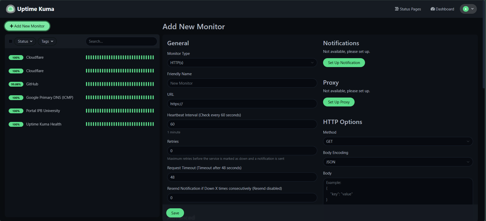
    <p><i>Gambar 3. Formulir Konfigurasi Penambahan Target Monitor Baru</i></p>
</div>

### 4. Pemantauan Transport Layer (TCP Port Cloudflare)
Memantau keandalan jabat tangan TCP pada port 443 IP Cloudflare `1.1.1.1`.

<div align="center">
    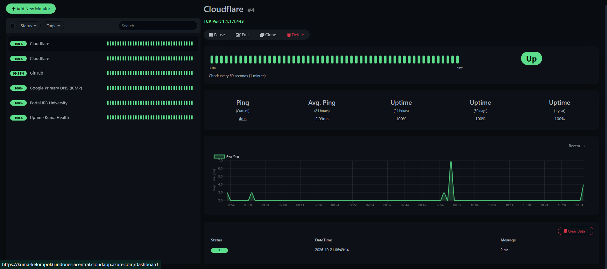
    <p><i>Gambar 4. Pemantauan Layer Transport TCP Port Cloudflare (1.1.1.1:443)</i></p>
</div>

### 5. Pemantauan Application Layer (DNS Record)
Memantau kecepatan dan ketepatan resolusi A-Record nama domain `google.com` melalui resolver Cloudflare.

<div align="center">
    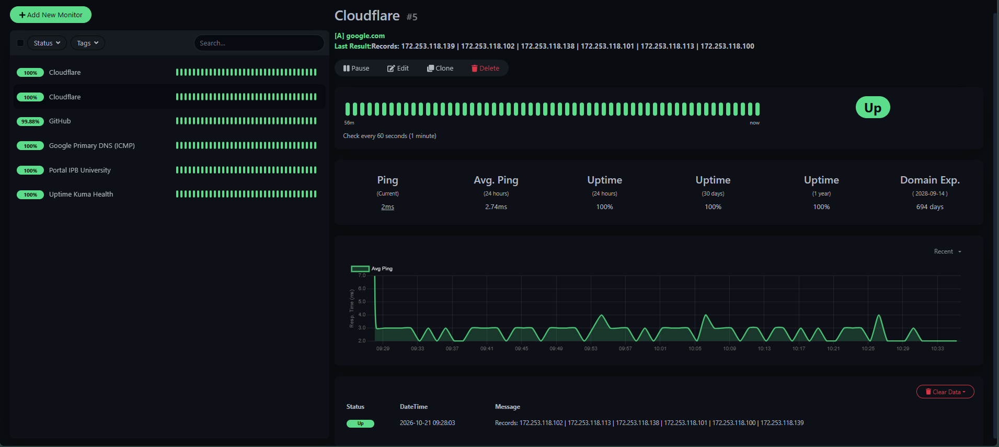
    <p><i>Gambar 5. Pemantauan Application Layer Resolusi DNS Record google.com</i></p>
</div>

### 6. Pemantauan Web Service & SSL Expiry (GitHub)
Memantau ketersediaan situs web HTTPS GitHub beserta pelacakan otomatis masa berlaku Sertifikat SSL.

<div align="center">
    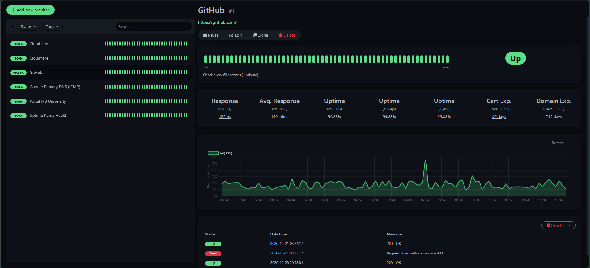
    <p><i>Gambar 6. Pemantauan Layanan HTTP & SSL Expiry GitHub</i></p>
</div>

### 7. Pemantauan Network Layer (ICMP Ping Google DNS)
Pengujian latensi dasar jaringan (*Round Trip Time*) ke Google Primary DNS (`8.8.8.8`).

<div align="center">
    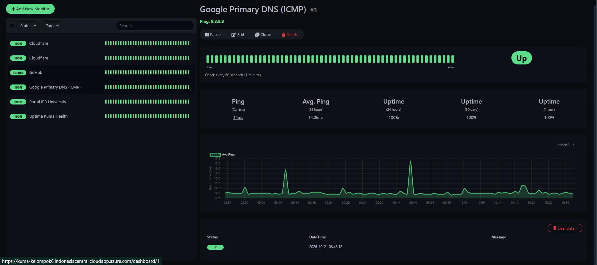
    <p><i>Gambar 7. Pemantauan Network Layer ICMP Ping RTT Google DNS (8.8.8.8)</i></p>
</div>

### 8. Pemantauan Web Kampus (Portal IPB University)
Memantau ketersediaan situs web utama IPB University (`https://ipb.ac.id/`) dengan verifikasi kode respon `200 OK`.

<div align="center">
    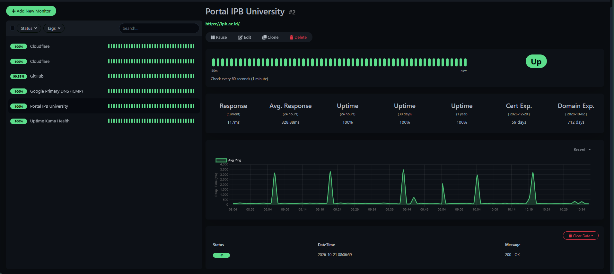
    <p><i>Gambar 8. Pemantauan Layanan Web Portal IPB University</i></p>
</div>

### 9. Pemantauan Host-Level (Docker Socket Inspection)
Memantau status kesehatan kontainer lokal (`uptime-kuma`) secara *native* melalui komunikasi Unix Domain Socket.

<div align="center">
    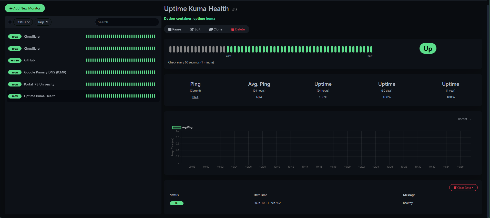
    <p><i>Gambar 9. Pemantauan Health Check Docker Container via Local Socket</i></p>
</div>

### 10. Pengelolaan & Editor Status Page Publik
Mengatur tampilan halaman status publik dengan slug `/status/public` untuk mentransparansikan kondisi ketersediaan layanan kepada publik.

<div align="center">
    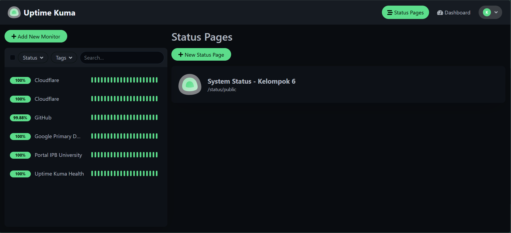
    <p><i>Gambar 10. Daftar Pengaturan Halaman Status Publik</i></p>
</div>

<div align="center">
    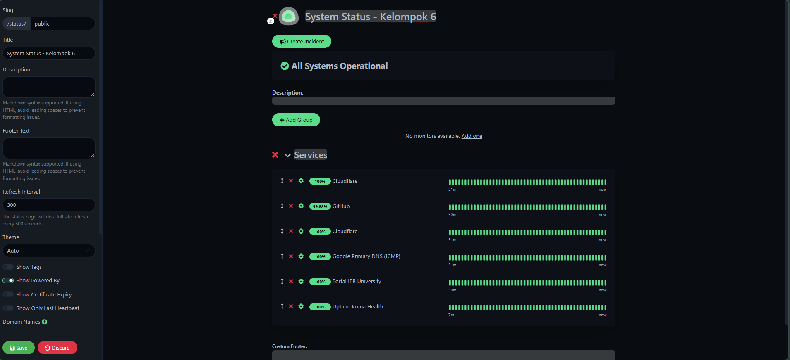
    <p><i>Gambar 11. Editor Konfigurasi Tampilan Public Status Page (/status/public)</i></p>
</div>

### 11. Pengaturan Global & Entry Page
Mengatur zona waktu sistem (`Asia/Jakarta`) dan mengarahkan Entry Page ke halaman status publik.

<div align="center">
    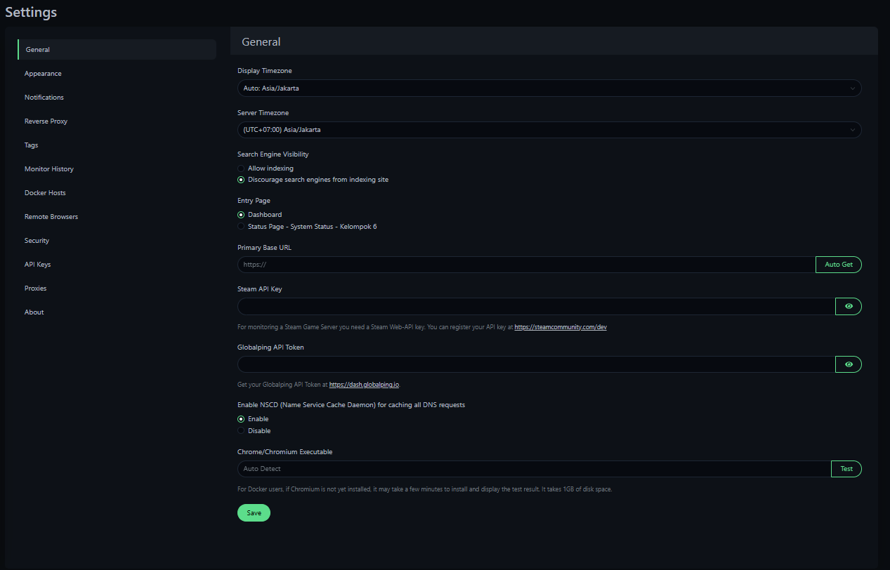
    <p><i>Gambar 12. Panel Pengaturan Sistem dan Global Configurations</i></p>
</div>

---

## Pembahasan
[`^ kembali ke atas ^`](#top)

### Perbandingan dengan Aplikasi Sejenis

Data perbandingan diambil dari dokumentasi resmi dan pengujian langsung pada beberapa aplikasi pemantauan jaringan dan infrastruktur sejenis:

1. **Uptime Kuma**: Fitur utama meliputi pemantauan multi-protokol, halaman status publik, integrasi notifikasi melimpah, dan grafik latensi *real-time*. Kebutuhan sumber daya sangat ringan (RAM < 512 MB). Berlisensi MIT (*open source*).
2. **UptimeRobot**: Layanan pemantauan web dan port komersial berbasis SaaS. Tidak memerlukan server sendiri, tetapi paket gratis dibatasi maksimal 50 monitor dengan interval minimal 5 menit.
3. **Grafana + Prometheus**: Stack pemantauan metrik server dan jaringan kelas enterprise. Sangat kaya fitur namun memerlukan konfigurasi awal (*learning curve*) yang relatif kompleks.
4. **Datadog / Statuspage.io**: Platform pemantauan skala besar berbasis cloud terpusat. Berfitur lengkap namun berbiaya lisensi sangat mahal.

#### Tabel Matriks Perbandingan

| Kriteria | Uptime Kuma | UptimeRobot | Grafana + Prometheus | Datadog / Statuspage |
| :--- | :--- | :--- | :--- | :--- |
| **Model Layanan** | *Self-Hosted* | SaaS (Cloud) | *Self-Hosted* | SaaS (Cloud) |
| **Lisensi** | MIT (*Open Source*) | Proprietary | Apache 2.0 (*Open Source*) | Proprietary / Commercial |
| **Batas Paket Gratis** | **Tidak Ada** (Sesuai server) | Maksimal 50 Monitor | **Tidak Ada** | Uji coba terbatas |
| **Interval Minimal** | **Hingga 20 Detik** | 5 Menit (Gratis) | Fleksibel | Fleksibel |
| **Kebutuhan Resource**| **Sangat Ringan** (RAM 512MB) | Tidak butuh server | Sedang - Tinggi | Tidak butuh server |
| **Kemudahan Setup** | **Sangat Mudah** (1-Click Docker) | Sangat Mudah (Daftar) | Sedang - Cukup Sulit | Mudah |
| **Status Page Publik** | Gratis & Terintegrasi | Berbayar (Paket Pro) | Perlu Tool Tambahan | Berbayar |
| **Privasi Data** | Terkontrol di VPS Sendiri | Dikelola Pihak Ketiga | Terkontrol di VPS Sendiri | Dikelola Pihak Ketiga |

---

### Pendapat & Analisis

Dari pengalaman instalasi dan penggunaan, Uptime Kuma menawarkan keseimbangan terbaik antara **kemudahan penggunaan**, **efisiensi sumber daya**, dan **fitur kustomisasi**. Penggunaan Docker Engine dan Caddy Reverse Proxy di Azure VPS membuat proses *deployment* menjadi sangat ringkas tanpa harus mengelola perpanjangan sertifikat SSL secara manual.

#### Kelebihan Uptime Kuma
- **100% Gratis dan Open Source** (Lisensi MIT), tanpa batasan jumlah monitor atau frekuensi *check*.
- **Sangat ringan**, dapat berjalan stabil pada server VPS dengan spesifikasi 1 vCPU dan RAM 1 GB.
- **Dukungan integrasi notifikasi sangat luas** (Telegram, Discord, Email, Webhook) tanpa biaya tambahan.
- **Pemantauan Docker Socket** memungkinkan pengecekan kesehatan kontainer internal secara *native*.
- **Data tersimpan mandiri** pada database SQLite lokal sehingga privasi data terjamin.

#### Kekurangan Uptime Kuma
- **Single Probe Location**: Pemantauan dilakukan dari satu lokasi server VPS (Central Indonesia), sehingga pengukuran latensi merefleksikan titik perspektif server tersebut.
- **Skalabilitas SQLite**: Sangat efisien untuk ratusan monitor, namun kurang ideal untuk pengelolaan puluhan ribu monitor bersamaan pada infrastruktur raksasa.

---

## Referensi
[`^ kembali ke atas ^`](#top)

1. **Uptime Kuma Official Repository**: [https://github.com/louislam/uptime-kuma](https://github.com/louislam/uptime-kuma)
2. **Uptime Kuma Official Documentation & Wiki**: [https://github.com/louislam/uptime-kuma/wiki](https://github.com/louislam/uptime-kuma/wiki)
3. **UptimeRobot Official Documentation & Features**: [https://uptimerobot.com/](https://uptimerobot.com/)
4. **Prometheus Monitoring Documentation**: [https://prometheus.io/docs/introduction/overview/](https://prometheus.io/docs/introduction/overview/)
5. **Grafana Documentation**: [https://grafana.com/docs/grafana/latest/](https://grafana.com/docs/grafana/latest/)
6. **Datadog Infrastructure Monitoring**: [https://docs.datadoghq.com/](https://docs.datadoghq.com/)
7. **Atlassian Statuspage Official Guide**: [https://www.atlassian.com/software/statuspage](https://www.atlassian.com/software/statuspage)
8. **Caddy Web Server Documentation**: [https://caddyserver.com/docs/](https://caddyserver.com/docs/)
9. **Docker Engine Reference Manual**: [https://docs.docker.com/engine/](https://docs.docker.com/engine/)
10. **Microsoft Azure Virtual Machine Documentation**: [https://learn.microsoft.com/en-us/azure/virtual-machines/](https://learn.microsoft.com/en-us/azure/virtual-machines/)
11. **Let's Encrypt / ACME Protocol**: [https://letsencrypt.org/how-it-works/](https://letsencrypt.org/how-it-works/)
12. **Modul Praktikum Komunikasi Data dan Jaringan Komputer (KDKJ) IPB**: [https://github.com/auriza/komdat-lab](https://github.com/auriza/komdat-lab)
